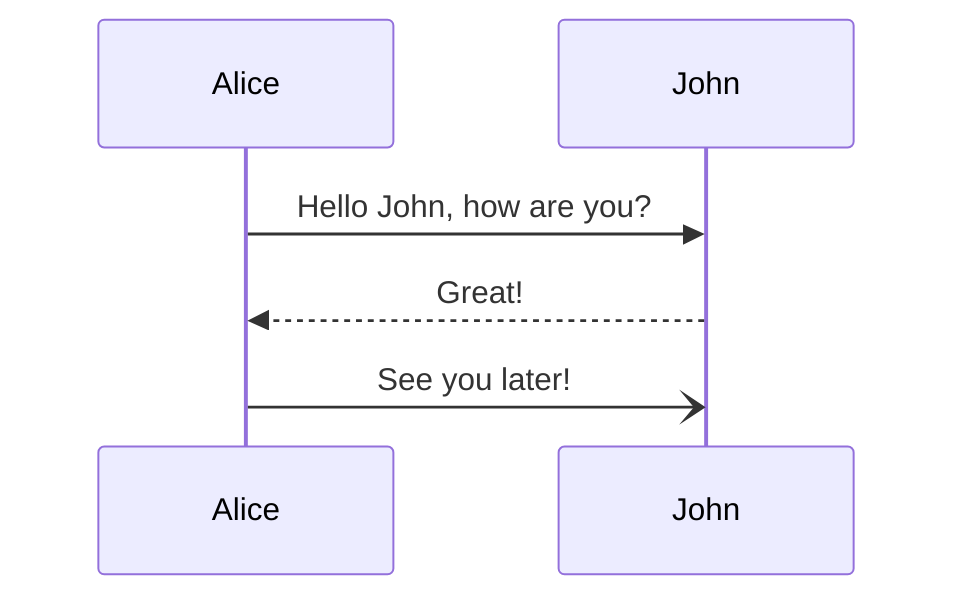

# Markdown in Minifolio

Minifolio uses [Markdown](https://www.markdownguide.org/) for formatting body content of each item. All of the normal bells and whistles should work as expected, with some additional niceties:

## Inline HTML

```html
<em>wow isn't that lovely!</em>
```

<em>wow isn't that lovely!</em>

## Sheet music using ABC notation

Minifolio allows the use of [ABC Notation](https://abcnotation.com/) for displaying sheet music.

```html
<score lang="ABC">
X: 1
T: Epitome of an Enigma
C: Zarhym Raider
M: 2/2
L: 1/8
K: C#min
G2|g2 fe d2 c2 | B2 F2 G2 EF | G2 AB A2 G2 | F2 D2 E2 |]
</score>
```

<score lang="ABC">
X: 1
T: Epitome of an Enigma
C: Zarhym Raider
M: 2/2
L: 1/8
K: C#min
G2|g2 fe d2 c2 | B2 F2 G2 EF | G2 AB A2 G2 | F2 D2 E2 |]
</score>

Wow that appears to be extremely broken. I think I will need to do a bug fix for that, oopsies!

## Diagrams using Mermaid

You can embed [mermaid]() diagrams.

````md

````

